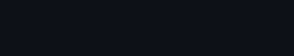
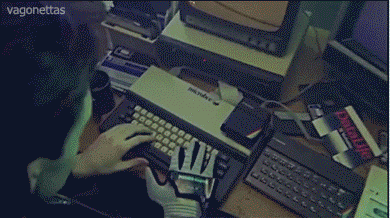
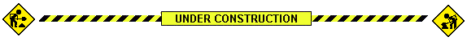

<!-- Banner de saludo -->

  

<h3 align="center">
  🚀 Second-year student pursuing a dual degree in 
  <b>Cross-Platform (DAM)</b> & <b>Web Application Development (DAW)</b>
</h3>

 

<!-- Sección de Humor: Tabla sin bordes para mantener los GIFs alineados -->

  <table>
    <tr>
      <td align="center"><b>Expectation 🕶️</b></td>
      <td align="center"><b>Reality 🐱</b></td>
    </tr>
    <tr>
      <td align="center">
        
      </td>
      <td align="center">
        
      </td>
    </tr>
  </table>

 

<!-- Sección de Tech Stack (Iconos de tecnologías típicas de DAM/DAW) -->
<h3 align="center">🛠️ Tech Stack & Tools</h3>

  

 

<!-- Estadísticas de GitHub centradas y ampliadas -->
<h3 align="center">📊 GitHub Stats</h3>

  
  

 

<!-- Contacto y enlaces -->
<h3 align="center">🌐 Connect with me</h3>

  
  

 

<!-- Footer -->

  

